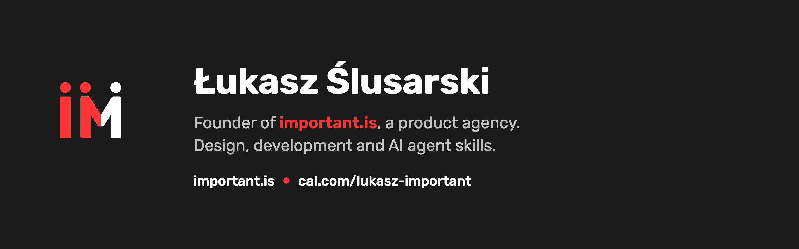

<a href="https://important.is"></a>

# Skills

[](https://cal.com/lukasz-important/spotkanie-30-minut) [](https://important.is)

Agent Skills by [Łukasz Ślusarski](https://github.com/lukasz-slusarski), founder of [important.is](https://important.is), for Claude Code and other agents that read the `SKILL.md` format.

**Looking for good skills from other authors?** See [CATALOG.md](CATALOG.md): a curated list of the most useful community skills for marketing, design, office documents, websites and working with agents.

Each skill here is a folder in `skills/` with a `SKILL.md` and optional `references/` and `scripts/`.

## Skills

| Skill | What it does |
|---|---|
| [ai-content-labeling](skills/ai-content-labeling/SKILL.md) | Decides whether a post, image, video, audio or text must be labeled as AI-generated under EU AI Act Article 50 and the rules of Meta, LinkedIn, TikTok, YouTube and X. Gives a verdict, the legal basis and a ready label. EU and Poland focus, sources checked on 8 Oct 2026. |
| [ai-routing](skills/ai-routing/SKILL.md) | Decides who does the work (Claude subagent, Codex, Antigravity, GLM, Kimi) to save Claude usage limits at the same quality, with a brief template. |
| [ai-delegate](skills/ai-delegate/SKILL.md) | Hands a bounded coding task to Antigravity, GLM or Kimi in the background, then reviews the diff and lands it. Wrapper scripts with limit checks and cost logs. |
| [mac-clipboard](skills/mac-clipboard/SKILL.md) | Puts text the agent wrote straight into the macOS clipboard, on request only. Optional hook for Claude Code. |

## Install

Claude Code (plugin marketplace):

```
/plugin marketplace add lukasz-slusarski/skills
/plugin install lukasz-skills@lukasz-slusarski-skills
```

Other agents (Cursor, Codex, Gemini CLI and more) via [skills](https://github.com/vercel-labs/skills):

```bash
npx skills add lukasz-slusarski/skills
```

Manually: copy a skill folder to `~/.claude/skills/`.

## Work with me

Need help choosing or building skills for your team? [Book a 30 min call](https://cal.com/lukasz-important/spotkanie-30-minut) or visit [important.is](https://important.is).

## Disclaimer

The skills support decisions; they are not legal advice. Laws and platform rules change: every skill that depends on them states the date its sources were checked.

## License

MIT, see [LICENSE](LICENSE). Files derived from other projects carry their own notice (see `THIRD_PARTY_NOTICES.md` inside a skill).
